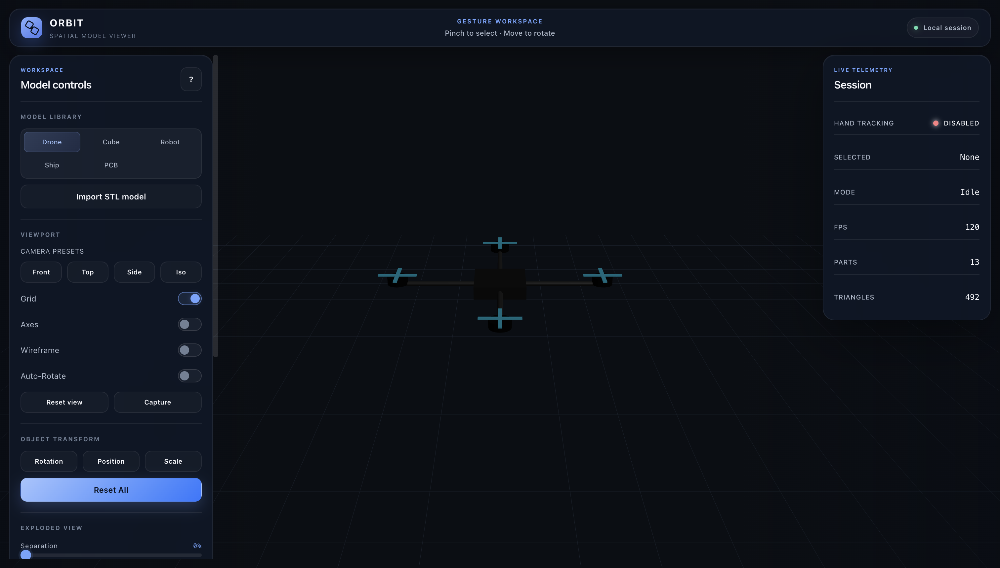
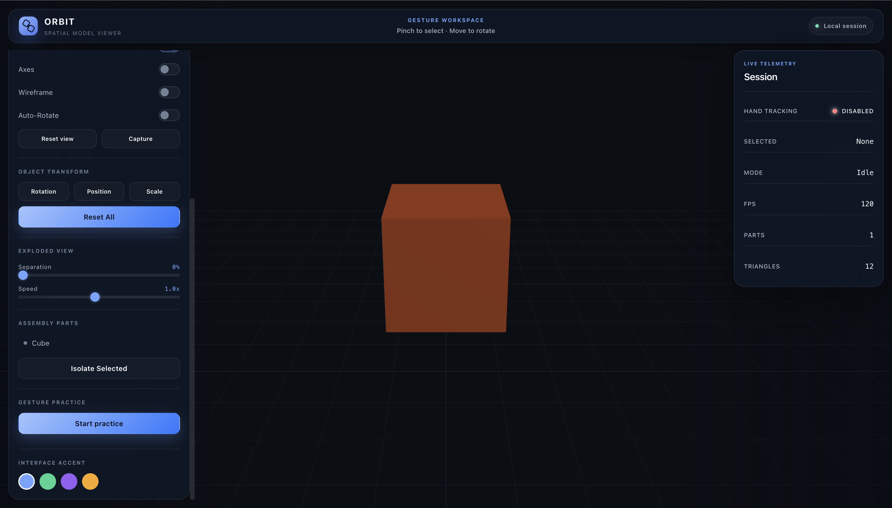

# Orbit

Orbit is a browser-based 3D model viewer. It uses a webcam and MediaPipe hand tracking. You can rotate, move, scale, separate, isolate, and inspect a 3D model with hand gestures or standard controls.

Orbit processes camera frames in the browser. It does not send camera frames to a server.

## Screenshots

<!-- SCREENSHOTS_START -->
### Model workspace



### Inspection controls


<!-- SCREENSHOTS_END -->

## Main functions

- Import an STL file.
- View included demonstration models.
- Rotate, move, and scale a model.
- Separate an assembly with the explode control.
- Isolate a selected part.
- Use camera presets and display controls.
- Capture the current view as an image.
- Use hand gestures when a camera is available.

## Requirements

- Node.js 20.19 or later
- npm
- A browser with WebGL 2 and WebAssembly support
- A webcam for gesture control
- A secure browser context for camera access

Use a current version of Chrome, Edge, Firefox, or Safari. Browser support for camera and WebAssembly functions can differ.

## Included assets

The repository includes these runtime assets:

- The MediaPipe hand-landmark model
- The MediaPipe WebAssembly files
- A demonstration STL file

You do not need to download these files after you clone the repository.

## Install Orbit

1. Clone the repository.
2. Open a terminal in the repository.
3. Install the packages.

```bash
npm ci
```

## Start Orbit

```bash
npm run dev
```

Open the address that Vite prints. Allow camera access if you want to use hand gestures.

## Use hand gestures

1. Put one hand in the camera frame.
2. Keep the hand in good light.
3. Point with the index finger to select an item.
4. Pinch the thumb and index finger to grab.
5. Move the hand to manipulate the selected model.

Use the on-screen controls if gesture input is not available.

## Build Orbit

```bash
npm run build
```

The build output is in `dist/`. Git does not include this generated directory.

## Preview the build

```bash
npm run preview
```

## Keyboard controls

| Key | Function |
| --- | --- |
| `R` | Reset the selected part. |
| `C` | Reset the camera. |
| `E` | Change the explode state. |
| `I` | Change the isolation state. |
| `W` | Change the wireframe state. |
| `G` | Change the grid state. |
| `A` | Change the automatic rotation state. |
| `D` | Show or hide debug data. |
| `?` | Show the keyboard help. |

## Project structure

```text
public/mediapipe/  Hand model and WebAssembly files
src/core/          Hand tracking and gesture state
src/gestures/      Gesture detectors
src/manipulation/  Model transformations
src/scene/         Three.js scene and model loading
src/styles/        Visual system
src/ui/            Interface components
```

## Privacy

Orbit requests camera access only after you enable hand tracking. Camera frames remain in the browser process. Orbit does not include analytics, an account system, or a remote inference API.

## Security

Read [SECURITY.md](SECURITY.md) before you report a vulnerability. Do not attach a private model or camera image to a public issue.

## License

Orbit is open-source software under the [MIT License](LICENSE).

Third-party components have separate terms. Read [THIRD_PARTY_NOTICES.md](THIRD_PARTY_NOTICES.md).
